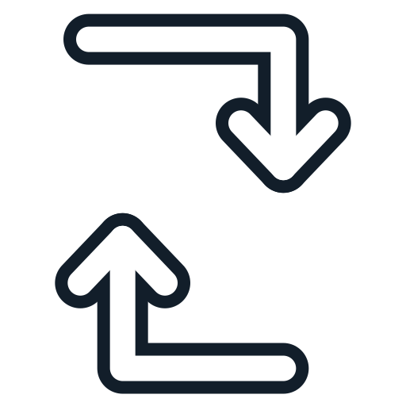

[](https://github.com/heathcliff26/kde-trayrotate/actions/workflows/ci.yaml)
[](https://coveralls.io/github/heathcliff26/kde-trayrotate)
[](https://github.com/heathcliff26/kde-trayrotate/actions/workflows/editorconfig-check.yaml)
[](https://github.com/heathcliff26/kde-trayrotate/actions/workflows/coverprofiles.yaml)

# kde-trayrotate

Quickly toggle the KDE auto rotate setting for your screen from the system tray.

## Table of Contents
- [kde-trayrotate](#kde-trayrotate)
  - [Table of Contents](#table-of-contents)
  - [Usage](#usage)
    - [Meaning of different icons](#meaning-of-different-icons)
  - [Installation](#installation)
    - [Download binary](#download-binary)
      - [Uninstalling](#uninstalling)
    - [Fedora Copr](#fedora-copr)


## Usage

Simply start the app. You will then see the icon in the system tray. Clicking/Tapping the icon will toggle the auto rotate setting.

The app uses `kscreen-doctor` to interact with the KDE Screen settings. Requires Plasma 6.7+.

### Meaning of different icons

The app will show different icons depending on the current state of the auto rotate setting. The used icons are:

| Off                                           | On                                             | Unknown                                                                    |
| --------------------------------------------- | ---------------------------------------------- | -------------------------------------------------------------------------- |
|  |  |  |
| Won't rotate the screen                       | Will rotate the screen                         | Unable to find out, likely because no monitor supports it.                 |

## Installation

### Download binary

1. Download the [latest release](https://github.com/heathcliff26/kde-trayrotate/releases/latest)
2. Unpack the archive
3. Install the app for your user by running:
   - You can install it globally by running the script with `sudo`
```bash
./install.sh -i
```

#### Uninstalling

1. Switch to the folder where you have the installation script
2. Uninstall by running:
   - Run as `sudo` if you installed it globally
```bash
./install.sh -u
```
3. Delete the folder.

### Fedora Copr

The app is available as an rpm by using the fedora copr repository [heathcliff26/kde-trayrotate](https://copr.fedorainfracloud.org/coprs/heathcliff26/kde-trayrotate/).
1. Enable the copr repository
```bash
sudo dnf copr enable heathcliff26/kde-trayrotate
```
2. Install the app
```bash
sudo dnf install kde-trayrotate
```
